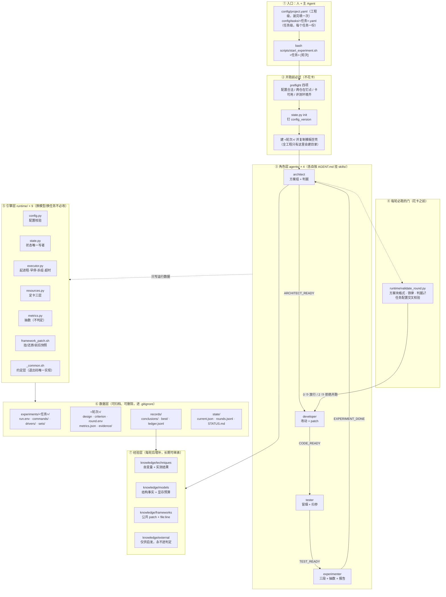
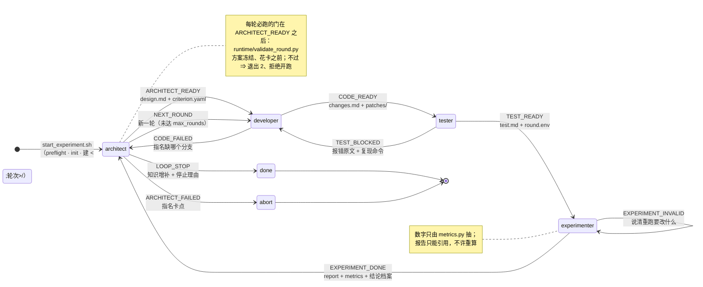
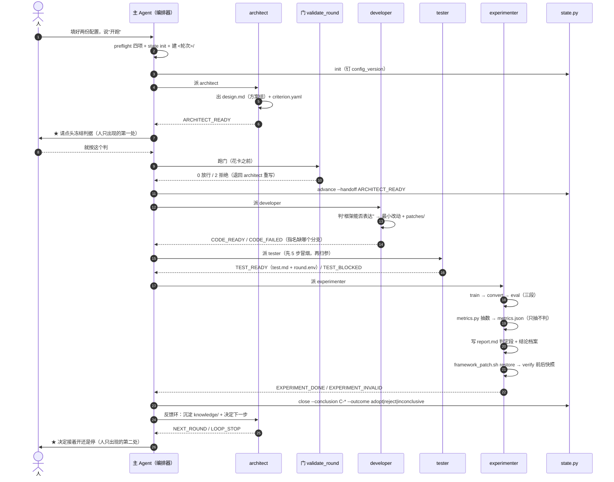
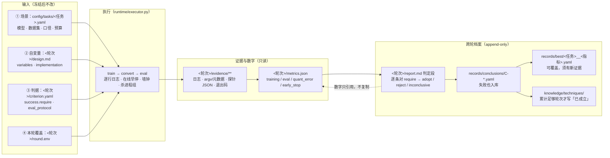

# 设计说明（DESIGN）—— `low-precision-train-agent`（`lpta`）全景

> **给谁看**：第一次接触本工程的人，或要向别人介绍它的人。本文回答六个问题：
> 原则与架构是什么、角色与状态机怎么转、skill 怎么设计、怎么开跑、结果怎么维护、经验怎么长期沉淀。
>
> **边界（重要）**：本文是**全景导航**，不是权威落点。任何人问「这个字段叫什么／这个值域多大／
> 这个 token 谁来发」，答案只在下列文件里；本文与它们冲突时**以它们为准**，并请顺手改本文。
>
> | 你想知道 | 权威落点 |
> |---|---|
> | 模块关系、调用图、落点判据 | `docs/ARCHITECTURE.md` |
> | 状态机、十条转移、`state/` 三件 | `docs/PIPELINE.md` ＋ `runtime/state.py` |
> | 配置字段全集与路径优先级 | `docs/CONFIG.md` ＋ `config/task.schema.json` |
> | 退出码含义 | `runtime/README.md` §2（实现在 `runtime/_common.sh`） |
> | 仓库级约定（谁能改什么、禁令） | `AGENTS.md` |
> | 操作步骤（装、填、开跑） | `README.md` ＋ `deploy/PREREQUISITES.md` |
> | 每个版本改了什么 | `ReleaseNotes.md` |
>
> 当前版本：`VERSION` = **0.18.15**。

---

## 0. 原则、架构、能力、依赖

### 0.1 一句话与它解决的真问题

> 把低精度训练实验的**机制**与具体**模型/任务配方**彻底解耦。

机制 = 起进程、定卡、早停、抽数、配置校验、状态、挂/还原补丁、每轮必跑的门 —— **换模型、换任务不必改**。
配方 = 模型名、任务名、数据集、评测口径、量化方案、阈值 —— **只出现在 `config/` 与任务目录／轮次目录**。

它解决的是四类真实事故，每一条都对应一处机械卡口：

| 事故（都真实发生过） | 本工程的处置 |
|---|---|
| 「阈值写了两处，人改的那处没有读者」 | 一个事实只有一个落点（§0.2 ③）＋ 门在花卡前对账 |
| 「报告里的数字跟证据对不上」 | 数字只由 `runtime/metrics.py` 抽，报告只能**引用** |
| 「跑完没还原框架，下一轮与这一轮互相污染」 | 改动只经轮次 `patches/` 挂载，跑完 `verify` 前后快照 |
| 「说了要监控量化误差，其实没测」 | `unmeasured` 与「达标」在 `metrics.json` 里是**两个不同的值** |

### 0.2 六条设计原则

1. **机制与配方解耦。** 判据：换模型/换任务时这个文件会不会必须改？——会 ⇒ 任务目录；不会 ⇒ `runtime/`。
2. **工程框架从简。** 不为"可能有用"加开关；每加一个阀门都要能回答"谁在什么时候读它"。
   历史上删掉过的阀门（`loop.auto_probe`、`stop_conditions.no_progress_rounds`、`eval.metrics`、
   `round.budget_cards`、`variables.yaml` 变量字典）都写在 `ReleaseNotes.md` 里，理由都是"没有读者"。
3. **一个事实只有一个落点。** 同一内容不许在 YAML 与 Markdown 里各写一份。越界的失败方式是**静默的**
   ——把「怎么实现」写进设计、把阈值写进配置、把模型名写进 `runtime/`，都会让下一轮复现不出来，
   所以有 `devtools/check_decoupling.py` 把它做成机械卡口。
4. **fail-closed。** 解析不出配置根、字段缺失、占位未替换、判据与任务配置不一致 ⇒ 一律退出 `2`，
   在**花卡之前**拒绝开跑。宁可当场停，不许静默降级（`CODE_FAILED` 必须指名缺哪个分支）。
5. **判定与数字分离。** 抽数器只抽数、不判定；判定归 experimenter 的报告与结论档案，且**只能引用**
   `metrics.json` —— 判断是你的，算数不是。
6. **人只出现两处。** ① 填配置；② architect 写完判据后**点头冻结**。其余由主 Agent 派四个角色推进。
   （第二处不可省：判据是"这一轮算不算成"的定义权，机器不该替人签字。）

### 0.3 分层架构



**怎么读这张图**（从外到内三条线）：

1. **纵向是"谁推动谁"**：人写配置 → 主 Agent 跑 `start_experiment.sh`（唯一入口）→ 派角色 → 角色调引擎。
2. **中间的菱形是门**：`runtime/validate_round.py` 在 architect 交方案之后、花卡之前卡一道，不过就退回重写。
3. **虚线是"只写运行数据"**：角色不碰 `runtime/`，引擎不碰 `config/` 里的场景值 —— 越界由
   `devtools/check_decoupling.py` 机械判失败。

> 图的源就是上面这段 mermaid（可直接改）；渲染由查看器负责（GUI／GitHub／VS Code 原生支持）。
> 要 PNG 进 PPT 时再导出，命令见 `docs/diagrams/README.md`。

三层纪律（放错的后果都是静默失败）：

- **引擎层**里出现模型名／任务名／阈值／本机绝对路径 ⇒ `devtools/check_decoupling.py` 判失败。
- **契约层**（`config/task.schema.json`、`templates/`）是骨架：使用者抄，但**不改**骨架本身。
- **数据层**可整体归档／可删除（GB 级，进 `.gitignore`）；**经验层**与 `records/` 是 append-only 的耐久档案（KB 级，可进 git）。

### 0.4 能力清单（照实写，包括不能做什么）

| 能力 | 状态 | 落点 |
|---|---|---|
| 配置校验（字段级、fail-closed） | ✅ 已实现 | `runtime/config.py validate` |
| 一轮的每轮门：方案块格式、铁律、判据⇄任务配置交叉校验 | ✅ 已实现（`--selftest` 44/44） | `runtime/validate_round.py` |
| 起进程、逐行日志、在线早停（平台停＝`converged`／退出 0）、杀进程组、墙钟超时、ckpt 保留 | ✅ 已实现（49/49） | `runtime/executor.py` |
| 定卡三层（策略／实测／决策＋来源）、占用扫描 | ✅ 已实现（61/61） | `runtime/resources.py` |
| 抽数（loss／评测／QSNR／早停／三段耗时）→ `metrics.json` | ✅ 已实现（127/127） | `runtime/metrics.py` |
| 状态机（`init`／`advance`／`close`） | ✅ 已实现 | `runtime/state.py` |
| 框架补丁挂载／还原／前后快照校验 | ✅ 已实现 | `runtime/framework_patch.sh` |
| 约定层（路径解析、run.env/round.env、退出码、`--resume`） | ✅ 已实现（52/52） | `runtime/_common.sh` |
| 开跑入口与预检（配置／两仓钉点／卡／评测环境） | ✅ 已实现 | `scripts/{start_experiment,preflight}.sh` |
| 出厂／升级／卸载／自证 | ✅ 已实现（92 文件，managed 89 ＋ seeded 3） | `devtools/make_release.py` ＋ `deploy/*` |
| 评测（lm_eval）真跑 | ⚠️ 驱动与接线齐备，**本工程侧无完整真跑留档** | `experiments/<任务>/drivers/`、`skills/eval-lm-eval` |
| **训练框架**侧量化补丁（不是评测框架） | ⚠️ 公共 patch 3 个文件／2 组：QSNR 探针（core ＋ llm 各一个）、mxfp4 mask fix；任务专用改动按轮 `<轮次>/patches/` | `knowledge/frameworks/patches/` |
| 多轮自动连开 | ❌ **刻意没有**：`loop.max_rounds` 是声明式边界，引擎不替你停 | `docs/PIPELINE.md` §6 |

> **先分清两个「框架」**（写混了就会问"补丁是打给谁的"）：
>
> | | **训练框架**（MindSpeed-LLM ＋ 核心层 MindSpeed） | **评测框架**（lm_eval） |
> |---|---|---|
> | 在本工程是什么 | 任务配置 `train.framework_repo`／`core_repo` 指向的检出；**改动只经 patch 挂载、跑完还原** | 任务配置 `eval.lm_eval.*` 指的一个 pip 包（钉版本）；**不改它** |
> | 补丁落点 | `knowledge/frameworks/patches/<名字>/<仓>/<仓内路径>.patch`（"已证明稳定"的公共 patch）＋ `<轮次>/patches/`（任务专用，见 `design.md` 的 `implementation.patch`） | **没有补丁**：本工程是 `experiments/<任务>/drivers/lm_eval_driver.py` 一个**驱动**（拼 argv 并执行） |
> | 量化相关的现状 | QSNR 探针（量出"假量化把张量弄坏了多少"）、mxfp4 mask fix（内核把 ≤−127 硬清零的 bug） | **量化感知评测的补丁本轮没做** ⇒ 驱动跑出来的是**主权重精度**的数字，不许拿它冒充 w4a4（任务配置里已写明） |

> 「零件齐备 ≠ 跑过」：端到端演练（P9）是全程 `--dry-run`，机械结果见 `docs/PIPELINE.md` §8。
> 真跑三段需要真的卡、真的框架检出、真的评测 venv —— 那属于使用者那条线。

### 0.5 依赖（分三层，别混）

**① 装（缺一个装不起来）** —— 详表在 `deploy/PREREQUISITES.md` §1。

| 要求 | 为什么 |
|---|---|
| Linux ＋ `bash` ≥ 4 | 三段入口与 `_common.sh` 用数组、`set -u` |
| `python3` ≥ 3.8 | 引擎六件是 Python |
| **`PyYAML`** | ★ **唯一的第三方 Python 依赖**：配置与 `state/` 全靠 `import yaml` |
| `sha256sum`（coreutils） | 安装器靠它判"这个文件被改过没有" |
| `git` | 只用来 `git init` 目标目录；**不替你做任何提交** |

**② 跑实验（装完之后）**

| 需要 | 唯一落点 |
|---|---|
| 训练框架检出（如 MindSpeed-LLM ＋ 核心层仓） | 任务配置 `train.{framework_repo,framework_head,core_repo,core_head}` |
| 卡与定卡策略 | `config/project.yaml` 的 `devices.*`（＋ `runtime/resources.py` 实测） |
| 数据根与数据盘 | `config/project.yaml` 的 `data.root`／`data.runs`，任务配置 `train.data_path` |
| 起点权重 | 任务配置 `model.start.{format,path}`（`scripts/convert_weights.sh` 幂等转换） |

**③ 评测**

| 需要 | 唯一落点 |
|---|---|
| 评测解释器（venv，含 `lm_eval`） | 任务配置 `eval.lm_eval.{package,version,python}`；`scripts/install_env.sh` 可建 |
| 数据集 | 任务配置 `eval.datasets[].path`（**给文件，不给目录**） |
| 驱动 | 任务目录 `drivers/`（本任务特异化，接 `lm_eval` 的 argv） |

### 0.6 目录地图（一屏）

| 落点 | 一句话用途 | 谁写 |
|---|---|---|
| `agents/<角色>/AGENT.md` × 4 | 角色五段职责 ＋ `skills:` 挂载表 | 建设者 |
| `skills/<名字>/SKILL.md` × 11 | 过程性知识（怎么做），按 `AGENT.md` 顺序加载 | 建设者 |
| `runtime/`（9 件） | 引擎 | 建设者（升 `VERSION`） |
| `config/` | 模型名/任务名/阈值/路径的唯一落点 ＋ 字段契约 | 使用者填任务配置 |
| `templates/` | 每轮照抄的骨架（`design.md`／`criterion.yaml`／`run.env`／`commands/`） | 建设者 |
| `experiments/<任务名>/` | 任务目录：三段入口、命令、驱动、集合；`rounds/<轮次>/` 是输入与档案 | 使用者 |
| `records/` | 跨轮档案：`conclusions/`（append-only）、`best/`、`ledger.jsonl` | `state.py close`／experimenter |
| `state/` | 现在在哪、下一步派谁 | **只经** `runtime/state.py` |
| `knowledge/` | 可继承的经验（四类） | architect（每轮后） |
| `scripts/` | 开跑入口 ＋ 对工程外部的操作（装卸 agent/skill、建 venv） | 建设者 |
| `devtools/`＋`tests/` | **开发期**自检与正负对照（**出厂包不含**） | 建设者 |
| `docs/` | 人读的机制说明（本目录） | 建设者 |

---

## 1. 角色、状态转移、状态机

### 1.1 四个角色（`reviewer`／`arbiter` 已废除，零残留）

| Agent | 一句话 | 输入 | 输出（落点） | 成功 token | 失败/分支 token |
|---|---|---|---|---|---|
| `architect` | 把含糊需求变成一组（3–6 个，含组合）可实验方案 ＋ 跑前冻结的判据 | 任务配置、`knowledge/**`、上一轮 `report.md` | `<轮次>/{design.md,criterion.yaml}`；`knowledge/` 增补 | `ARCHITECT_READY` | `ARCHITECT_FAILED`（指名卡点）、`NEXT_ROUND`、`LOOP_STOP` |
| `developer` | 把方案落成框架侧改动；改不动就当场报错 | `design.md` 的 `variables:`／`implementation:`、任务配置 | `<轮次>/{changes.md,patches/}` | `CODE_READY` | `CODE_FAILED`（指名缺哪个分支） |
| `tester` | 先冒烟再扫参，交可复现候选配置 | `changes.md`、`criterion.yaml` | `<轮次>/{test.md,round.env}` | `TEST_READY` | `TEST_BLOCKED`（报错原文＋复现命令） |
| `experimenter` | 跑训练→转换→评测→抽数，出报告与结论，跑完还原框架 | `round.env`、`criterion.yaml`、`scheme_resolved.json` | `<轮次>/{report.md,metrics.json,artifacts.json,evidence/}`、`records/conclusions/C-<序号>.yaml` | `EXPERIMENT_DONE` | `EXPERIMENT_INVALID`（说清重跑要改什么） |

**一个 token 只有一个生产者。** `runtime/state.py advance` 会校验"当前 `stage` 是不是该 token 的生产者"，
所以编排器**写不坏状态机**（非法 token ⇒ 退出 2）。

废除的角色，能力去向：机制"真装上了吗"的验证证据 ⇒ developer 写进 `changes.md`（可复现命令）＋ tester 冒烟复跑；
瓶颈定位 ⇒ tester；结论裁决 ⇒ 上移到 experimenter 的 `report.md` 判定段。数字纪律没放松：
报告里每个数字只能引用 `metrics.json`。

### 1.2 状态转移（十条）

| # | 从 → 到 | token | 交接物 | 进入下一步的条件 |
|---|---|---|---|---|
| 1 | `architect → developer` | `ARCHITECT_READY` | `design.md` ＋ `criterion.yaml` | 方案组落盘；成功/证伪条件填好；**花卡之前**门退出 `0` |
| 2 | `architect → abort` | `ARCHITECT_FAILED` | 卡点说明 | 需求在当前硬件/框架下不可满足，且指名卡点 |
| 3 | `developer → tester` | `CODE_READY` | `changes.md` ＋ `patches/` | 改动清单带「文件/为什么/怎么验证」；≥1 条机制生效验证命令 |
| 4 | `developer → architect` | `CODE_FAILED` | 卡点 ＋ 缺哪个分支 | 框架表达不了方案；**不许**填假参数静默降级 |
| 5 | `tester → experimenter` | `TEST_READY` | `test.md`、`round.env` | 冒烟通过（能起、loss 有限无异常跳变、不 OOM、步数对得上）；候选带 run 命令与预期耗时 |
| 6 | `tester → developer` | `TEST_BLOCKED` | 报错原文 ＋ 复现命令 | 暴露的是代码缺陷，不能靠调参绕过 |
| 7 | `experimenter → 自己` | `EXPERIMENT_INVALID` | 失败证据 ＋ 触发阈值与步数 | 训练无效（发散/早停/NaN/墙钟超时）；**必须说清重跑要改什么** |
| 8 | `experimenter → architect` | `EXPERIMENT_DONE` | `report.md`（含判定）＋ `metrics.json` ＋ 结论档案 ＋ `evidence/` ＋ 还原校验记录 | 三段跑完、证据落盘、数字已抽、结论入库（失败也入库）、框架已还原且校验一致 |
| 9 | `architect → developer` | `NEXT_ROUND` | 新一轮 `design.md` ＋ `criterion.yaml` | 人/上层编排决定接着开，未达 `loop.max_rounds`，知识增补已完成 |
| 10 | `architect → done` | `LOOP_STOP` | 知识增补记录 ＋ 停止理由 | 人决定不开／达 `max_rounds`／连续 `no_progress_rounds` 无进展 |

### 1.3 状态机图



**怎么读这张图**：实线是正常推进（`ARCHITECT_READY → CODE_READY → TEST_READY → EXPERIMENT_DONE`），
往回走的箭头是三条回炉路径（`CODE_FAILED` 回 architect、`TEST_BLOCKED` 回 developer、
`EXPERIMENT_INVALID` 回自己），两条虚线出口是 `abort`／`done`。门挂在 `ARCHITECT_READY` **之后**：
方案冻结、花卡之前，不过就退回 architect。

三条不可绕：

- **轮次目录只有 `scripts/start_experiment.sh` 会建。** 跳过开跑不是靠自觉，而是目录不存在、后面每一步都拒绝。
- **冻结判据是人的闸门。** 主 Agent 必须问人「就按这个判吗」，人点头才进 developer。
- **编排器就是主 Agent**，不许再派一个"编排子代理"：编排没有算法（读一个字段、派一个 agent、交一个 token），
  多一层只增加排障路径，还会把人工闸门压扁。

### 1.4 `state/`：唯一写者与三件产物

| 文件 | 可变性 | 谁读 | 内容 |
|---|---|---|---|
| `state/current.json` | 整体覆盖 | 上层编排（机器） | `stage`／`round`／`task_id`／`framework_version`／`config_version`／`artifacts{root,round_dir,runtime_root}`／`framework_state{head,core_head,clean}`／`last_handoff`／`last_conclusion`／`next_action`／`loop{rounds_done,no_progress_rounds}`／`blockers` |
| `state/rounds.jsonl` | **append-only** | 上层编排（机器） | 每轮结束由 `close` **恰好追加一行**；首行是 `_note` 骨架说明（解析方跳过） |
| `state/STATUS.md` | 整体覆盖 | 人 | 由 `current.json` **渲染**的摘要（不是第二个真相） |

三条子命令（**别手跑**，除排障；开跑走 `start_experiment.sh`）：

```bash
python3 runtime/state.py init    --task <任务名> [--round <轮次>]   # 建/覆盖 current.json 与 STATUS.md
python3 runtime/state.py advance --handoff <TOKEN>                 # 改 stage/last_handoff/next_action
python3 runtime/state.py close   --conclusion C-<序号> --outcome <adopt|reject|inconclusive>
```

纪律：`advance` **不**追加 `rounds.jsonl`（轮次行只由 `close` 追）；`close` 的数字只引用判据的
`success.require`（第一条为主指标）与 `metrics.json` —— 缺了就退出 `2`（不许收口、不许补 0）；
`state.py` **不跑 git、不猜**：`framework_state.clean` 初始是 `null`（未核验），只有调用方显式给
`--framework-restored {true,false}` 才落这个事实（「空输出 ≠ 干净」）。

### 1.5 多轮的边界：声明式，没有自动开关

| 字段 | 默认 | 语义 |
|---|---|---|
| `loop.max_rounds` | 3 | 这条线最多连开几轮；到额就**应**给 `LOOP_STOP`（由人/主 Agent 执行，引擎不自动停） |
| `loop.no_progress_rounds` | 2 | 连续几轮主指标无实质变化就建议停整条线（阈值取自 `criterion.yaml` 的 `success.require`，不另发明） |

三条硬约束：① 开新一轮的决定权在人；② 连开不改变判定权（每轮仍必须写 `report.md` 并入库）；
③ 不放松「不许原样重跑」——新一轮必须与上一轮有**可指名**的差别，写进新一轮 `design.md`。

---

## 2. skill 设计原则与清单

### 2.1 原则

1. **skill 是过程性知识，不是脚本。** 它讲"怎么做、为什么这么做、什么算做完"，**不放阈值、不放模型名**
   ——阈值在配置与判据里，模型名在 `config/`（否则 `check_decoupling.py` 判失败）。
2. **一个角色一个加载顺序。** `AGENT.md` 的 frontmatter 有 `skills:` 键（本工程新增的键），
   正文第①段按这个顺序加载；`devtools/validate_agents.py` 逐条查「路径真实存在」。
3. **一段知识一个家。** 同一件事不在两个 skill 里各写一遍：例如「退出码怎么读」只在 `run-observation`，
   「脚本管什么、配置管什么」只在 `train-recipe`。
4. **写清边界与失败态。** 每个 skill 都要能回答「做到什么算完」「做不到时交什么 token、带什么证据」。
5. **配套 `references/`。** 长表格、字段清单、坑清单放 `references/`，正文只留决策路径。

### 2.2 十二个 skill

| skill | 挂给谁 | 何时用 | 交什么 |
|---|---|---|---|
| `scheme-design` | architect | 拿到需求、要产出一组方案 | 3–6 个方案块（自变量＋`requires_code`＋依据 `file:line`）＋判据 |
| `local-knowledge` | 全部角色 | 要向知识库取证 | 引用哪条、可信度、为什么不进判定 |
| `knowledge-curation` | architect | 收到 `EXPERIMENT_DONE` 要写回 | 知识条目增补／`result` 更新 |
| `code-change` | developer | 要把方案落成框架改动 | 判"框架能否表达"＋`changes.md` 改动清单＋patch |
| `train-recipe` | developer/tester/experimenter | 要把配置变成一次可复现的训练 | 参数怎么来、脚本管什么、配置管什么 |
| `model-and-code-fetch` | developer/tester/experimenter | 权重或代码还没取到本机、或要切到指定分支/提交 | `scripts/fetch_model.sh`／`fetch_code.sh` 的落点与自证、钉点同步清单（切了 ref 要改成什么）；失败一律归「环境未就绪」，不归 5/6 |
| `weights-convert` | tester/experimenter | 起点权重还不存在（只有 HF，模型只吃 mcore） | `scripts/convert_weights.sh` 的正确用法与验收 |
| `autotune` | tester | 要冒烟与扫参 | 5 步冒烟结论 ＋ 粗扫→收窄→复验的候选配置 |
| `run-observation` | tester/experimenter | 要读一次执行的观察 | 退出码怎么归类、loss 曲线怎么看、QSNR 怎么读 |
| `eval-lm-eval` | experimenter | 要跑评测 | lm_eval 装法/接法、口径冻结、结果不可比时的处置 |
| `report-and-conclusion` | experimenter | 要写报告与结论 | `report.md` 判定段（逐项＋汇总）＋结论档案 |
| `bootstrap-eval-env` | 主 Agent | 开跑前要建评测 venv | 建 venv、钉版本、回填任务配置、回读自证 |

### 2.3 skill 与 runtime 的分工

| | `runtime/`（机制） | `skills/`（知识） |
|---|---|---|
| 形态 | 可执行、有退出码、有自检 | 文档、可被引用、无副作用 |
| 谁读 | 脚本与门（机器） | 角色（模型） |
| 变了要不要升 `VERSION` | 要 | 要（`skills/` 在机制清单里） |
| 出错时 | 退出 `2`／`5`／`6` | 不会"出错"，只会被忽略 —— 所以纪律写进 `AGENT.md` 第①段 |

一句话：**能机械判的进 `runtime/`，只能靠理解力的进 `skills/`。** 门（`validate_round.py`）与 skill 不重复：
门查的是**格式与自洽**（方案块能不能被执行），skill 讲的是**判断与取舍**（这个方案值不值得试）。

---

## 3. 开跑：配置怎么写、实验怎么起

### 3.1 三步上手

```bash
# ① 工程级配置（装完填一次）：数据盘、卡、路径
$EDITOR config/project.yaml

# ② 任务级配置（每个任务一份）：模型、评测、两仓钉点、产物根
cp config/tasks/_TEMPLATE.yaml config/tasks/<任务名>.yaml && $EDITOR config/tasks/<任务名>.yaml
python3 runtime/config.py validate config/tasks/<任务名>.yaml     # 不过 ⇒ 逐条打印字段路径

# ③ 开跑：preflight → 钉 state → 建 <轮次>/ → 打印"下一步派谁"
bash scripts/start_experiment.sh <任务名>
```

装（若还没装）：`tar xzf lpta-<版本>.tar.gz && cd lpta-<版本> && bash deploy/install.sh <目标目录>`
→ `bash deploy/verify_install.sh <目标目录>` → `python3 runtime/state.py init`。详表：`deploy/PREREQUISITES.md`。

### 3.2 `config/project.yaml`（工程级，装完填一次）

| 字段 | 填什么 | 填错会怎样 |
|---|---|---|
| `data.root` | 数据盘根（如 `/data`）。唯一被 `_common.sh` 取用、export 成 `LP_DATA_ROOT` | 三段脚本拿不到数据根 ⇒ 起训练前退出 2 |
| `data.runs` | 三段产物的**默认落点**（`<data.runs>/<任务名>`；`run.env` 的 `LP_WORK_DIR` 可覆盖） | 指到小盘 ⇒ 训练中途写爆；指到不存在的盘 ⇒ `init` 警告（不改 rc），起作业时才失败 |
| `devices.usable` / `devices.reserved` | 允许用／排除的卡 | 定不出来 ⇒ preflight 第③项 ✗ |
| `devices.require_explicit` | `true`：卡号只能由 `runtime/resources.py` 给出 | 设 `false` 会让"抢低号卡"重新可能 |
| `paths.*` | 五个目录（`config/tasks`／`experiments`／`records`／`state`／`knowledge`） | 改它等于改所有下游路径 |

卡号优先级（高 → 低）：`LP_CARDS` 环境变量 ＞ 已导出的 `ASCEND_RT_VISIBLE_DEVICES` ＞ `devices.*` 策略 ＋ 实测占用。

### 3.3 `config/tasks/<任务名>.yaml`（任务级，每个任务一份）

字段全集与逐条说明见 `docs/CONFIG.md` §4；这里只给**心智模型**（六块）：

| 块 | 说什么 | 最常踩的坑 |
|---|---|---|
| `task_id` / `model.*` | 任务名＝目录名；模型名与**目标精度** | 精度写 `w4a4` 还是框架的 `w4a4-mxfp4`，取决于 `--qat-scheme` 认什么 |
| `model.source` / `model.start` | **两个不同事实**：从哪来 vs 这一轮 `--load` 吃哪份 | 混用会让"复现出处"和"起点权重"分叉 |
| `train.*` | 语料路径、框架检出与两个钉点、`monitor_metrics` | 写 `quant_error` ⇒ 自动开探针（声明即开关） |
| `eval.*` | `lm_eval` 版本与解释器、数据集、口径、驱动 | `datasets[].path` 给**目录** ⇒ 配置门放行、驱动 `is_file()` 失败 |
| `artifacts.root` | `default` 或绝对路径（轮次目录 = `<root>/rounds/<轮次>/`） | 指小盘 ⇒ 轮次产物写爆 |
| `stop_conditions.*` | **全生效**（0.18.18 起）：`max_steps` 真驱动 `--train-iters`／`quant_error_max` 换算成 QSNR 地板／`loss.*` 与 `wall_clock_hours` 由 `_common.sh` 直接读、传给执行器（在线早停与墙钟闸） | 以为这些得靠角色转抄进判据 —— 那就等于没有 |
| `intents[]` | 多轮实验的起点想法，**append-only**；一条可以是字符串，也可以是 `{text,external,loop}` 对象（= 一次尝试：检索计划 ＋ 单次轮次预算） | 改既有条目（不参与 `config_version`，但会让历史对不上） |
| `loop.*` / `objective` | 声明式边界／一句目标 | 以为到了 `max_rounds` 引擎会自动停（不会） |

### 3.4 任务目录（写一次、每轮复用）

```text
experiments/<任务名>/
├── README.md          # 本任务怎么跑、坑、验收命令（任务知识跟着任务走）
├── run.env            # 三段真正要跑的命令与环境变量（任务级唯一一份）
├── train.sh convert.sh eval.sh    # 三段入口：拼 argv ＋ 调 runtime/
├── commands/          # 型号几何写死的命令形状（train_cmd.sh 等）
├── drivers/           # 评测侧驱动（拼 lm_eval argv 并执行）
└── sets/<集合名>.txt   # 评测集合清单（一行一名）
```

两条硬规则：**① 每轮不再各写一份脚本**（轮次目录里出现同名脚本副本 ⇒ `check_round_layout.py` 退出 2）；
**② 轮次要改，只允许「加覆盖 / 加钩子」** ——`<轮次>/round.env`（不许重定义整条命令）或
`<轮次>/hooks/{pre_train,post_train,pre_eval,post_eval}.sh`。

### 3.5 一轮里的四个文件（别混四类旋钮）

| 文件 | 谁写 | 定什么 | 可变性 |
|---|---|---|---|
| `config/tasks/<任务名>.yaml` | 使用者 | **场景**（模型/数据集/预算/口径） | 定义任务时写；本轮冻结后不动 |
| `<轮次>/design.md`（受控 YAML 块） | architect | **选了什么**（`variables:`）＋**怎么落地**（`implementation:`＋`patches/`） | 冻结后不改 |
| `<轮次>/criterion.yaml` | architect 写、**人冻结** | **怎么算成**（`success.require` 列表）＋**何时停** | **跑后一字不改**；要改 ⇒ 新写一份用 `supersedes:` |
| `<轮次>/round.env` | tester | 本轮对命令的**覆盖**（变量值／追加 argv） | 本轮内定稿 |

`criterion.yaml` 的关键点：`success.require` 是**列表**（要几个指标写几条，全部满足才 adopt）；
每条以 `<数据集>/<尺子>` 开头，指标名解析不出来 ⇒ 门退出 2。判据**不含** `stop_conditions`
（0.18.18 起：早停阈值与墙钟的唯一落点是任务配置，引擎直接读）。旧轮次若仍写了 `max_steps`，
门会要求它与任务配置**相等**（兼容校验），写了也不生效。

### 3.6 开跑那一条命令做了什么

```bash
bash scripts/start_experiment.sh <任务名> [轮次]
```

它做四件事，**一件都不许由子代理代劳**：

1. `scripts/preflight.sh` —— 四项预检：① 任务配置合法 ② 两个框架仓都在钉点上 ③ 卡现在能用 ④ 评测环境齐。
   任一 ✗ ⇒ 退出 `2`，不花卡。
2. `runtime/state.py init` —— 钉 `config_version`，写 `state/` 三件。
3. **建 `<轮次>/` 目录**并从 `templates/` 复制 `design.md`／`criterion.yaml` 空壳（全工程只有它建目录）。
4. 打印"下一步该派谁"。

预检的常见失败与处置见 `README.md` §1.4（配置不过／钉点不一致／卡被占／轮次目录已存在）。

### 3.7 一轮的时间线：谁在什么时候做什么



**注意两处 `★`**：判据冻结、决定开不开下一轮 —— 全流程只有这两处必须由人拍板；其余都是角色与引擎在动。

### 3.8 人必须出现的两处

| 时机 | 你要判断什么 | 机器为什么不替你做 |
|---|---|---|
| architect 出完判据，进 developer 之前 | 「就按这个判吗」 | 判据决定了这一轮算不算成；签字权在人 |
| 每轮结束，architect 给 `NEXT_ROUND`／`LOOP_STOP` 时 | 接着开还是停 | 多花一次卡是人的预算决定，不是算法 |

---

## 4. 结果维护：产物、指标、日志、档案

### 4.1 产物落点

```text
<artifacts.root>/rounds/<轮次>/           # 默认 <paths.experiments>/<任务名>/rounds/<轮次>/
├── design.md criterion.yaml round.env    # 输入（冻结后不改）
├── scheme_resolved.json                  # 自变量展开结果（机器读）
├── changes.md patches/**                 # developer 的改动与补丁
├── test.md                               # tester 的冒烟与扫参结论
├── report.md                             # experimenter 的报告（含判定段）
├── metrics.json                          # ★ 数字的唯一落点（工具算出，谁都不许手改）
├── artifacts.json                        # 路径清单（产物在哪，机器读）
├── evidence/**                           # 原始证据：逐行日志、进程元数据、探针 JSON、退出码
└── patches/framework_{head,status}.{before,after}   # 框架前后快照（还原校验用）
```

`records/`（跨轮、append-only、KB 级、可进 git）与 `experiments/`（GB 级、可归档、进 `.gitignore`）**不合并**。

数据的来路与去路（同一张图的文字版：四类旋钮进去 → 证据与数字 → 跨轮档案）：



### 4.2 `metrics.json` 的四段

| 段 | 字段（要点） | 谁读 |
|---|---|---|
| `training` | `points`／`first_iter`／`last_iter`／`first_loss`／`last_loss`／`min_loss`／`max_loss`／`max_adjacent_rise`／`max_rel_to_best`／`nonfinite_iters`／**`observation`**／`observation_reasons`／`thresholds_used`／`is_verdict` | report、`state.py close` |
| `eval` | 目标侧与基线侧每个 `<数据集>/<尺子>` 的绝对值与 **Δ**、`baseline_ref`／`baseline_path` | report、结论档案 |
| `quant_error` | `status ∈ measured/unmeasured/probe_invalid`／`series`／`min_db`／`last_db`／`min_rel_err`／`last_rel_err`／`watchdog_tripped`／`reason` | report（记录项，**无 pass/fail**） |
| `early_stop` | 是否触发、触发原因与步数 | report、`state.py close` |

`training.observation` 三态必须分清：`ok`（点数够且有判据）／`insufficient_points`（有训练证据但点太少）／
**`not_applicable`（本轮没有训练段，例如基线轮只跑 convert+eval）**。把"没跑训练"记成"点数不足"是这类指标
最容易脏的地方，所以分界线是**证据文件在不在**，不是配置声明。

### 4.3 监控指标都有什么

| 指标 | 口径 | 阈值来源 | 命中后 |
|---|---|---|---|
| 相邻步 loss 跳变 | `max_adjacent_rise`（相邻两步比值） | 任务配置 → `stop_conditions.loss.jump_factor` | 在线早停 ⇒ 杀训练 ⇒ 退出 `5` ⇒ `EXPERIMENT_INVALID` |
| 末步/最好步 | `max_rel_to_best` | `loss.rel_to_best` | 同上 |
| 步数是否到点 | `last_iter` vs `max_steps` | 任务配置 `max_steps`（真驱动） | 记录 `steps_reached_max` |
| 墙钟 | 执行器计时 | 任务配置 `stop_conditions.wall_clock_hours`（唯一落点） | 杀整个进程组 ⇒ 退出 `5` |
| 量化误差 QSNR | 聚合 dB（weight＋activation 能量池化）、逐采样点比 | 任务配置 `quant_error_max` → `QAT_QSNR_FLOOR_DB = −20·log10(ε)` | 探针看门狗 kill 该 run ⇒ `EXPERIMENT_INVALID`（不许原样重跑） |
| 量化误差相对跌落 | 相对第 10 步掉 > 3 dB | **固定工程护栏**（无 YAML 旋钮） | 同上 |
| 评测指标 | `metrics.json.eval` 的每个 `<数据集>/<尺子>` 与 Δ | `criterion.yaml` 的 `success.require` | 报告逐项对账 |

换算只有一条关系：`ε = 10^(−QSNR/20)` ⇒ **26.02 dB = 5%**、30 dB = 3.16%、40 dB = 1%。

### 4.4 日志、证据与退出码

| 退出码 | 含义 | 谁来处置 |
|---|---|---|
| `0` | 成功 | —— |
| `1` | 未分类的运行期失败 | experimenter 归类后决定是否 `EXPERIMENT_INVALID` |
| `2` | 约定/契约/门不过（fail-closed） | 改配置或让 architect 重写方案，**不花卡** |
| `5` | **训练侧无效**（发散/早停/NaN/**墙钟超时**） | `EXPERIMENT_INVALID`，说清重跑要改什么 |
| `6` | **评测侧无效**（口径不全/驱动异常/结果不可比） | 本轮不出数字 |

码按「**哪一段**无效」切，不按「哪种失败形式」切。执行器落 `<轮次>/evidence/` 的东西：逐行日志、
进程元数据（argv、环境、起止时间、退出码、是否被杀）、探针 JSON。**证据只读**，谁都不许改。

### 4.5 报告与结论

- `report.md` 的判定段逐条对照 `success.require`：**全部满足 ⇒ `adopt`；任一不满足 ⇒ `reject`；
  某项缺数 ⇒ `inconclusive` 并点名缺哪项**。轮与轮的精度差异直接用 `metrics.json` 已算好的 Δ（覆盖全部指标）。
- `records/conclusions/C-<序号>.yaml` **append-only，失败也入库**（否则下一轮会重试同一个坑）。
- `state.py close --conclusion C-<序号> --outcome <adopt|reject|inconclusive>` 把这一轮收口，
  `rounds.jsonl` 恰好 +1 行。
- 每轮结束必须往 `ReleaseNotes.md` 追加一行：**框架版本 ＋ 配置版本 ＋ 框架仓库版本**（缺一个，事后就复现不出那一轮）。

### 4.6 现在到哪了，怎么看

```bash
cat state/STATUS.md                                                        # 人读
python3 -c "import json;print(json.load(open('state/current.json'))['next_action'])"   # 机器读
cat <轮次>/metrics.json | head -40                                         # 数字
```

---

## 5. knowledge：经验如何沉淀、如何长期演进

### 5.1 四类落点与可信度

| 落点 | 放什么 | 可信度 | 准入 |
|---|---|---|---|
| `knowledge/techniques/` | 可复用的技术方案（自变量＋实测结果，**成功与失败都记**） | 中—高（有本地证据） | 必须「评估跑完、结论入库」 |
| `knowledge/models/<模型名>.yaml` | 模型结构事实（arch／weights／显存预算算式） | 高（数值须现场读配置） | 拿不准的一律 `null`，**不许编** |
| `knowledge/frameworks/` | ① `patches/` 公共补丁（已证明稳定）② `<框架>-<主题>.md` 扫描理解（带 `file:line`） | 高（可直接落地） | 补丁要附 note ＋ `INDEX.md` 登记 |
| `knowledge/external/` | 已被**本地实验**证明有用的外部知识 | **仅供启发，永不进判定** | 四条缺一不可 |
| `records/{conclusions,best,ledger.jsonl}` | 跨轮结论／最优／唯一账本 | 高（机器生成） | append-only（`best/` 可覆盖，须有新证据） |

### 5.2 检索顺序（architect／developer／experimenter 都按这个走）

1. `records/best/` —— 现在的最好结果与口径是什么。
2. `knowledge/techniques/` —— 相近的自变量组做过没有（含 `rejected` 的坑）。
3. `knowledge/models/<模型名>.yaml` —— 结构事实与显存预算。
4. `knowledge/frameworks/` —— 框架能力与关键 `file:line`（判"能不能表达"）。
5. `records/conclusions/` —— 逐轮结论与失败原因。
6. `knowledge/external/` —— **只用来找方向**。

`knowledge/INDEX.md` 是入口（先读它，再按类取用）；格式的唯一来源是 `knowledge/README.md`。

### 5.3 写回流程（architect 收到 `EXPERIMENT_DONE` 后的三件事）

1. **判有没有记录价值（含多轮累计）**：同一方案的第二次/第三次验证**不新建条目**，只在既有
   `techniques/` 条目里追加 `evidence.rounds` 并更新 `result`；累计够了才写「已成立」。
2. **分流写入**：技术方案 ⇒ `techniques/`；外部知识 ⇒ `external/`（且须已被本地实验证明有用）；
   框架机制 ⇒ `frameworks/`（公共补丁进 `patches/<名字>/` ＋ note ＋ `INDEX.md`）。
3. **决定下一步**：`NEXT_ROUND` 或 `LOOP_STOP`。

纪律：结论里的数字**引用**轮次目录路径，不复制数值（`lint_knowledge.py` 会查结论档案的 `numbers_ref`）。

### 5.4 长期演进的四个机制

| 机制 | 作用 | 落点 |
|---|---|---|
| **版本三件套** | 框架版本／配置版本／框架仓库版本，三者齐了才复现得出那一轮 | `VERSION`、`config_version`、`train.*_head` |
| **CR（变更请求）流程** | 使用者诉求超出可写范围 ⇒ 写进 `paths.requests` 目录（默认 `requests/`）交建设者，轮次里只留一行指针，**不许就地改脚手架** | `<轮次>/change_request.md`／外部请求目录 ＋ `reply.md` |
| **开发期门禁** | `bash devtools/run_all.sh`（12 步：agents、轮次布局、解耦、知识、索引、状态、方案、禁用词、正/负对照、钉点负对照）；任一项非 0 ⇒ 整体非 0 | `devtools/` ＋ `tests/`（**出厂包不含**） |
| **出厂包** | `python3 devtools/make_release.py` ⇒ `dist/lpta-<版本>/`（正文 ＋ VERSION ＋ deploy/；安装计划注入 deploy/install.sh，剥离开发期标记、泄漏扫描） | `devtools/release/` |

`managed` 与 `seeded` 两类文件的差别要记住：升级会覆盖 `managed`；**`seeded` 永不覆盖**
（`config/project.yaml`、`knowledge/INDEX.md`、`records/conclusions/_EXAMPLE.yaml` —— 里面有使用者写的东西）。

### 5.5 反模式（都真实踩过）

1. **在 knowledge 里写"看起来对的错结论"**：拿护栏（3/15 dB）当精度判据；拿别人网络的阈值当自己的锚点。
2. **同一结论两处各写一份**：`techniques/` 写了，报告里又抄一遍数字 —— 数字要引用不复制。
3. **只记成功**：失败不入库 ⇒ 下一轮重试同一个坑。
4. **把 external 当判据**：外部知识只用来找方向，判定必须有本地证据。
5. **改了脚手架不升 `VERSION`**：事后没人知道那条结论是哪套机制跑出来的。

---

## 6. 补充：现状、约束、坑、术语

### 6.1 现状（照实写）

- 引擎 9 件全部实现，自检（0.20.2 实测）：`validate_round` 49/49、`metrics` 144/144、`executor` 67/67、
  `resources` 61/61、`_common.sh` 62/62；`devtools/run_all.sh` 12 步全过。
- 端到端演练（P9）是**全程 dry-run**；本工程侧**没有完整三段真跑的留档**（真跑要真卡、真框架、真 venv）。
- 出厂包 92 文件（managed 89 ／ seeded 3，含本文），`deploy/verify_install.sh` 全过。
- 多轮自动连开、评测侧量化补丁：**刻意没做**（前者由人决定，后者须先有自己的锚点）。

### 6.2 硬约束（改不动的边界）

| 约束 | 为什么 |
|---|---|
| 框架检出**永不提交改动**；改动只经轮次 `patches/` 挂载、跑完还原、前后快照必须一致 | 不还原，下一轮与上一轮互相污染 |
| `metrics.json`／`evidence/**`／`patches/framework_*.{before,after}` **只读** | 证据一旦可改，"复现"就没了 |
| `criterion.yaml` **跑后一字不改**（要改就新写一份用 `supersedes:`） | 判据可改 ⇒ 判定可被结果反向塑造 |
| 每轮目录里**不许**放三段脚本副本 | 两份脚本 ⇒ 两份行为 |
| 使用者不许就地改脚手架（`runtime/`、`agents/`、`skills/`、`templates/`、`scripts/` 等） | 改了引擎而没人发现 ⇒ 结论不可信；诉求走 CR |
| 阈值／模型名／任务名**不进** `runtime/`、`agents/`、`skills/`、`templates/` | `check_decoupling.py` 机械判 |

### 6.3 常见坑（Top）

1. **「配了但没人读」**：新增字段前先问"谁在什么时候读它"；没有读者就是死字段（本工程已删过 5 个）。
2. **「装上了但没生效」**：补丁挂载成功 ≠ 机制生效 —— 要有一条可复现的生效验证命令。
3. **「数字对不上」**：先看 `metrics.json`，不要自己重算、不要四舍五入。
4. **「跳过 preflight 直接开跑」**：构造上做不到（轮次目录只有 `start_experiment.sh` 建），别绕。
5. **「`datasets[].path` 给了目录」**：配置门放行、驱动 `is_file()` 失败，评测在花完卡之后才炸。
6. **「模型 provider 没声明 `thinking` 档位」**：0.20.2 起 `AGENT.md` 不再声明档位（走注册表默认），
   把坑从源头去掉；要显式指定就先确认 provider 已声明该档位，落点在 harness 侧
   （`~/.dsh/settings.yaml`），不在本工程目录里。
7. **「seeded 文件被当成升级会覆盖」**：`config/project.yaml` 升级不动它，装完必须自己填。

### 6.4 术语

| 词 | 含义 |
|---|---|
| 轮次（round） | 一轮完整实验：方案 → 改动 → 测试 → 三段执行 → 报告与结论 |
| 门（gate） | `runtime/validate_round.py`，每轮花卡前必过 |
| token | 角色交回的交接词（全大写），一个 token 只有一个生产者 |
| 判据（criterion） | 跑前冻结的「怎么算成、何时停」 |
| 尺子（ruler） | 某个数据集上的某个指标，写作 `<数据集>/<尺子>` |
| `config_version` | 任务配置内容 sha256 前 8 位（`cfg-9f2c1a40`） |
| QSNR | 量化信噪比（dB），`ε = 10^(−QSNR/20)`；聚合值 = weight＋activation 能量池化 |
| `EXPERIMENT_INVALID` | 这一轮无效（发散/早停/超时/看门狗 kill），不产生精度结论，不许原样重跑 |
| `LOOP_STOP` | 这条线停（人决定／到达 `max_rounds`／连续无进展） |

### 6.5 三种人怎么读这份工程

| 你是 | 读的顺序 |
|---|---|
| **第一次听说这个项目** | 本文 §0 → `README.md` §1 → `docs/PIPELINE.md` §1–§3 |
| **要动手跑实验** | `deploy/PREREQUISITES.md` → `README.md` §1（填两份配置） → 任务配置模板 → `skills/*` 对应角色那几篇 |
| **要改机制／扩能力** | `AGENTS.md` → `docs/ARCHITECTURE.md` → `docs/CONFIG.md` → `runtime/README.md` → `devtools/README.md` → `ReleaseNotes.md` 最近三段 |
